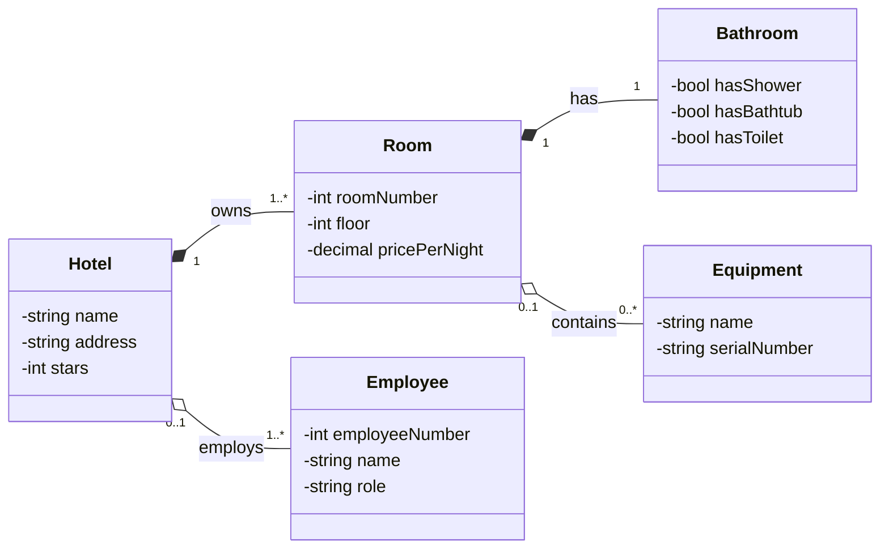

# M320 – M1 Klassendiagramm

Szenario: Hotelverwaltung (C#)

## Klassendiagramm

## Beziehungen

- **Hotel – Room (Komposition, 1 zu 1..*)**
  Zimmer gehören fest zum Hotel. Wird das Hotel gelöscht, werden auch die Zimmer gelöscht.

- **Room – Bathroom (Komposition, 1 zu 1)**
  Jedes Zimmer hat genau ein Badezimmer. Ohne das Zimmer gibt es das Badezimmer nicht.

- **Room – Equipment (Aggregation, 0..1 zu 0..*)**
  Ausstattung kann in ein anderes Zimmer verschoben werden. Sie existiert auch ohne Zimmer.

- **Hotel – Employee (Aggregation, 0..1 zu 1..*)**
  Mitarbeitende bleiben gespeichert, auch wenn das Hotel gelöscht wird.

Faustregel: Kann das Teil ohne das Ganze existieren? Nein = Komposition, Ja = Aggregation.

## Fragen

**Gehören Getter/Setter (Properties) ins Diagramm?**
Nein, nur wichtige Methoden.

**Gehört die Klasse mit der Main-Methode ins Diagramm?**
Nein, sie ist nur der Startpunkt des Programms.

**Wann macht eine bidirektionale Beziehung Sinn?**
Wenn beide Klassen einander kennen müssen.

**Reicht eine Assoziation ohne Pfeil?**
Ja. Ohne Pfeil ist die Richtung offen. Mit Pfeil sieht man, welche Klasse die andere kennt.