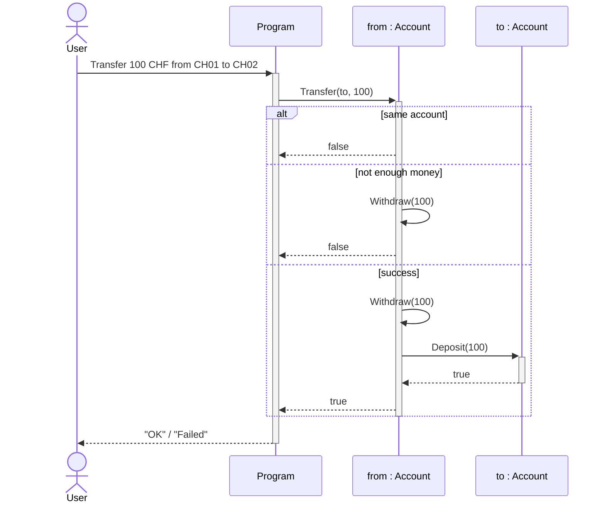

# M320 – M2 Sequenzdiagramm

Use Case aus der Bank-Simulation (D1): **Geld von einem Konto auf ein anderes überweisen**

## Use Case

Der Benutzer überweist 100 CHF von Konto CH01 auf Konto CH02.
Es gibt drei mögliche Abläufe:

1. **Gleiches Konto:** Absender und Empfänger sind identisch, die Überweisung wird abgelehnt.
2. **Zu wenig Geld:** `Withdraw` schlägt fehl, die Überweisung wird abgelehnt.
3. **Erfolg:** Das Geld wird beim Absender abgebucht und beim Empfänger gutgeschrieben.

## Sequenzdiagramm

## Ablauf in Worten

1. Der Benutzer wählt im Menü eine Überweisung.
2. `Program` ruft `Transfer(to, 100)` auf dem Absenderkonto auf.
3. Das Absenderkonto ruft bei sich selbst `Withdraw(100)` auf.
4. Wenn das klappt, ruft es `Deposit(100)` auf dem Empfängerkonto auf.
5. Die Rückgabewerte (`true` / `false`) gehen zurück bis zum `Program`, das "OK" oder "Failed" anzeigt.

## Statisch vs. dynamisch

- **Statisch** (z.B. Klassendiagramm aus M1): zeigt den Aufbau, also welche Klassen, Attribute und Beziehungen es gibt.
- **Dynamisch** (Sequenzdiagramm): zeigt den Ablauf zur Laufzeit, also wer wann welche Methode aufruft.

## Fragen zur Besprechung

**Wie werden Aufrufe von einem Objekt zu einem anderen dargestellt?**
Mit einem durchgezogenen Pfeil vom Aufrufer zum aufgerufenen Objekt, beschriftet mit Methode und Parametern, z.B. `Deposit(100)`.

**Was sind Swimlanes?**
Die senkrechten Spalten pro Teilnehmer (`User`, `Program`, `from`, `to`). Jede hat eine gestrichelte Lebenslinie nach unten.

**Kann ich sehen, wie lange ein Objekt "lebt"?**
Ja. Die Lebenslinie zeigt, dass das Objekt existiert. Die schmalen Balken (Aktivierung) zeigen, wann es gerade arbeitet.

**Wie wird ein Rückgabewert dargestellt?**
Mit einem gestrichelten Pfeil zurück zum Aufrufer, z.B. `true` oder `false`.

**Wie werden Aufrufe innerhalb desselben Objekts dargestellt?**
Mit einem Pfeil, der zum selben Objekt zurückgeht, z.B. `Withdraw(100)` beim Absenderkonto.

**Wie kann ich eine alternative Sequenz zeigen?**
Mit einem `alt`-Block. Jeder Fall hat eine Bedingung in eckigen Klammern, z.B. `[same account]`, `[not enough money]`, `[success]`. Für optionale Abläufe gibt es `opt`, für Schleifen `loop`.

## Fun Fact: ELIZA

ELIZA wurde 1966 von Joseph Weizenbaum am MIT entwickelt und gilt als eines der ersten Chatbot-Programme. Es simulierte einen Psychotherapeuten, indem es nach festen Regeln Schlüsselwörter im Text erkannte und die Aussagen des Benutzers als Fragen zurückgab. ELIZA verstand nichts. Trotzdem hielten viele Benutzer es für intelligent.