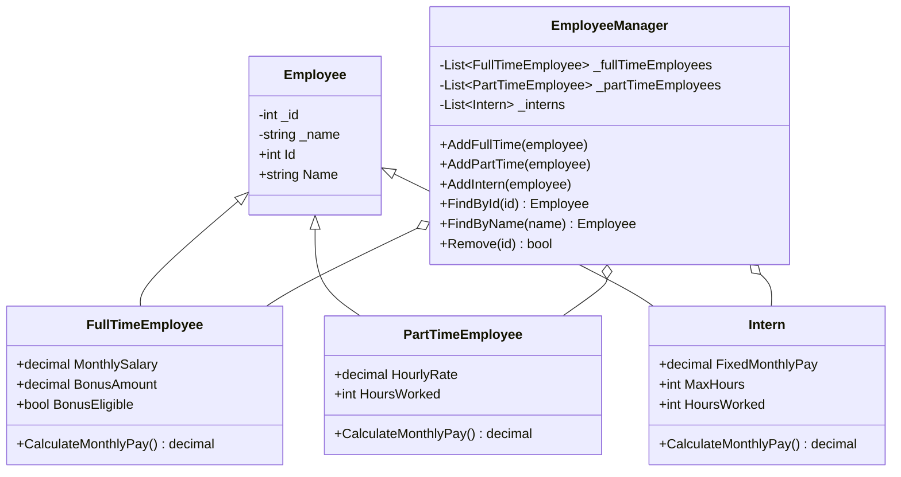

# M320 – V1 Vererbung anwenden um Spezialklassen zu erzeugen

## 1. Kurzbeschreibung und Start

Ein kleines C#-Konsolenprogramm zur Verwaltung von Mitarbeitenden. Es gibt drei Arten von Mitarbeitenden (Vollzeit, Teilzeit, Praktikum). Alle erben von der Basisklasse `Employee` und haben eigene Attribute und eine eigene Lohnberechnung.

Starten:

```
cd V1/EmployeeManagement
dotnet run
```

Beim Start sind fünf Beispiel-Mitarbeitende vorhanden. Menü: 1 erfassen, 2 anzeigen, 3 suchen, 4 entfernen, 5 Lohnauswertung, 0 beenden. Falsche Eingaben zeigen eine Fehlermeldung und führen zurück ins Menü.

## 2. Klassendiagramm



## 3. Gemeinsame und spezielle Attribute

| Attribut | Wo | Begründung |
|---|---|---|
| `Id` | `Employee` | Jede Person braucht eine Nummer, um sie eindeutig zu finden. |
| `Name` | `Employee` | Jede Person hat einen Namen. |
| `MonthlySalary` | `FullTimeEmployee` | Nur Vollzeit hat einen festen Monatslohn. |
| `BonusAmount` | `FullTimeEmployee` | Nur Vollzeit kann einen Bonus bekommen. |
| `BonusEligible` | `FullTimeEmployee` | Sagt, ob der Bonus ausbezahlt wird. Nur für Vollzeit relevant. |
| `HourlyRate` | `PartTimeEmployee` | Nur Teilzeit wird pro Stunde bezahlt. |
| `HoursWorked` | `PartTimeEmployee` | Die gearbeiteten Stunden bestimmen den Lohn. |
| `FixedMonthlyPay` | `Intern` | Praktikum hat einen festen Betrag, unabhängig von den Stunden. |
| `MaxHours` | `Intern` | Obergrenze der Stunden, gilt nur für Praktikum. |
| `HoursWorked` | `Intern` | Gearbeitete Stunden, begrenzt durch `MaxHours`. Hat andere Regeln als bei Teilzeit, darum steht es nicht in `Employee`. |

Was alle Arten gemeinsam haben, steht in `Employee`. Was nur eine Art braucht, steht in der Subklasse.

## 4. Validierungsregeln

Die Prüfung steht im Setter der Property. Der Konstruktor setzt die Werte über die Properties, darum ist jede Regel nur einmal geschrieben. Bei ungültigen Werten wird eine `ArgumentException` geworfen.

| Klasse | Attribut | Regel |
|---|---|---|
| `Employee` | `Id` | grösser als 0 |
| `Employee` | `Name` | nicht leer |
| `FullTimeEmployee` | `MonthlySalary` | grösser als 0 |
| `FullTimeEmployee` | `BonusAmount` | 0 oder mehr |
| `PartTimeEmployee` | `HourlyRate` | grösser als 0 |
| `PartTimeEmployee` | `HoursWorked` | 0 bis 180 |
| `Intern` | `FixedMonthlyPay` | 0 oder mehr |
| `Intern` | `MaxHours` | grösser als 0 |
| `Intern` | `HoursWorked` | 0 bis `MaxHours` |
| `EmployeeManager` | `Id` | darf noch nicht vorhanden sein (Prüfung beim Hinzufügen) |

## 5. Rechenbeispiele

| Nr. | Kategorie | Werte | Erwartetes Ergebnis |
|---|---|---|---|
| 1 | Vollzeit | 6000 + 1000 Bonus, `BonusEligible` = true | 7000 |
| 2 | Vollzeit | 6000 + 1000 Bonus, `BonusEligible` = false | 6000 |
| 3 | Teilzeit | 40.00 × 80 h | 3200 |
| 4 | Teilzeit | 35.50 × 120 h | 4260 |
| 5 | Praktikum | fix 1200, `MaxHours` 100, 80 h | 1200 |
| 6 | Praktikum | fix 1200, `MaxHours` 100, 120 h | `ArgumentException` (Stunden über `MaxHours`) |

## 6. Warum hat die Basisklasse keine Berechnungsmethode?

Das ist eine Vorgabe des Auftrags. Jede Subklasse hat darum ihre eigene Methode `CalculateMonthlyPay()`, und `Employee` hat keine (auch kein `abstract`, `virtual` oder `override`). Deshalb hält der `EmployeeManager` drei getrennte Listen: Er muss wissen, welche Art von Mitarbeitenden er vor sich hat, um die richtige Methode aufzurufen. Mit Polymorphismus geht das später einfacher, das kommt erst in V2.
